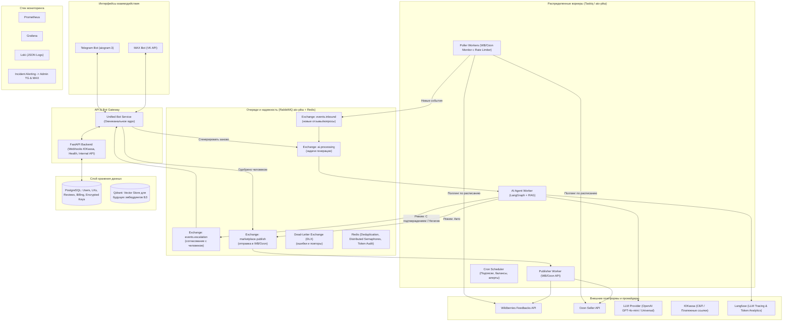
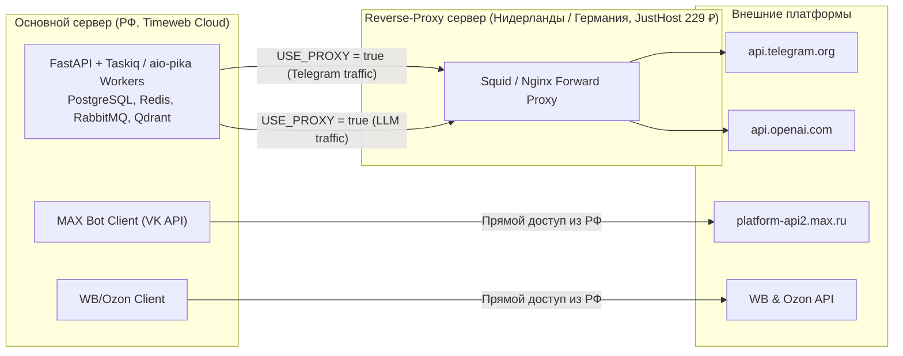
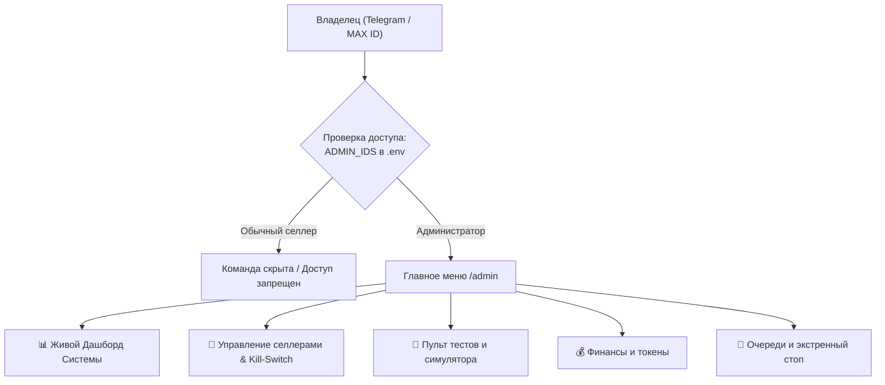
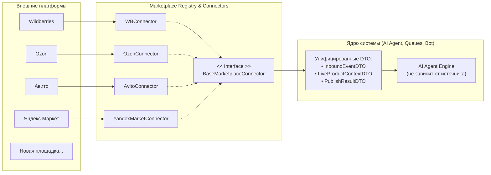
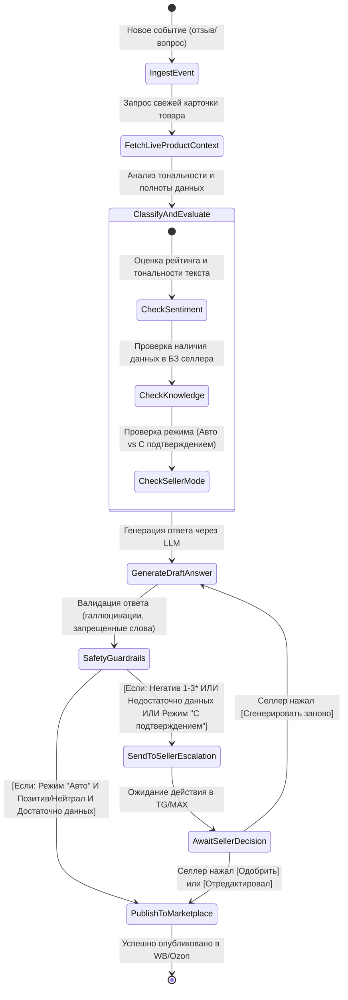
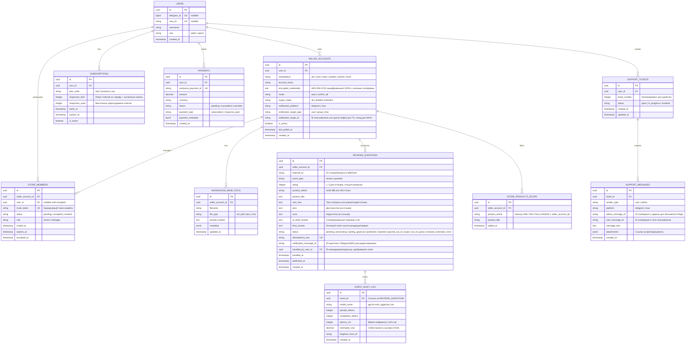

# Техническая спецификация: AI-агент для селлеров маркетплейсов (Wildberries & Ozon)

## 1. Введение и цели проекта

### 1.1. Назначение системы
Система представляет собой распределённый отказоустойчивый сервис с ИИ-агентом для автоматизации клиентской поддержки продавцов (селлеров) на маркетплейсах **Wildberries (WB)** и **Ozon**. 

Система осуществляет непрерывный мониторинг входящих отзывов и вопросов покупателей, анализирует контекст карточки товара и базы знаний селлера, формирует персонализированные ответы с использованием LLM и публикует их на маркетплейсах либо отправляет на согласование селлеру в мессенджеры.

### 1.2. Ключевые бизнес-цели MVP
* **Снижение нагрузки на селлера:** Автоматизация рутинных положительных и нейтральных отзывов (до 80-90% от общего потока).
* **Сохранение контроля и лояльности (Human-in-the-loop):** Гарантированная эскалация негативных отзывов (1-3 звезды), жалоб и вопросов с недостатком данных на подтверждение селлеру.
* **Омниканальность управления:** Полноценный интерфейс управления ботом и базой знаний через **Telegram** и национальный мессенджер **MAX (VK)**.
* **Рыночная 3-уровневая монетизация:** Прозрачная линейка тарифов («Старт» 990 ₽ / 150 ответов, «Бизнес» 2 490 ₽ / 500 ответов, «Профи» 4 990 ₽ / 1500 ответов) с возможностью докупки несгораемых пакетов ответов через ЮKassa (СБП/карты).
* **Высокая отказоустойчивость:** Поддержка 500+ активных селлеров, распределённый поллинг с защитой от блокировок по Rate Limits, абсолютная идемпотентность событий (защита от дубликатов ответов покупателям).

---

## 2. Архитектура системы

### 2.1. Концептуальная C4-схема



---

### 2.2. Сетевая топология и поддержка Прокси (Hybrid & Sovereign Modes)

Для обхода региональных блокировок (замедление/блокировка Telegram Bot API и недоступность OpenAI API из РФ) система проектируется с **двухсерверной гибридной топологией** и гибкой поддержкой прокси:



#### Режимы работы системы (переключатель в `.env`):
1. **Гибридный режим (`USE_PROXY = true` — Рекомендуемый):**
   * Telegram-бот и прямой OpenAI API `gpt-4o-mini` работают через выделенный дешёвый зарубежный прокси-сервер (JustHost Нидерланды, 229 ₽/мес).
   * MAX-бот, вебхуки ЮKassa и поллинг маркетплейсов работают напрямую из РФ без лишних промежуточных узлов.
   * Обеспечивается минимальная себестоимость токенов (~1.9 коп. за ответ) и высокая скорость.
2. **Суверенный режим (`USE_PROXY = false` — 100% РФ контур):**
   * Все исходящие запросы идут напрямую с российского сервера без внешних прокси.
   * В качестве мессенджера используется **MAX (VK)**.
   * В качестве LLM-провайдера подключаются российские модели **GigaChat** (Сбер) или **YandexGPT** (Яндекс) через универсальный абстрактный интерфейс.

---

## 3. Омниканальный интерфейс ботов (Telegram + MAX)

### 3.1. Принцип унификации
Ядро логики бота отделено от транспортных библиотек мессенджеров. Создаётся абстрактный слой событий `BotMessage`, `BotCallback`, `BotKeyboard`.
* **Telegram Adapter:** Реализован на `aiogram 3` (асинхронный, вебхуки/polling).
* **MAX Adapter:** Реализован на базе официального MAX Bot API (`platform-api2.max.ru`), работающий с вебхуками или Long Polling через асинхронный HTTP-клиент (`httpx`).

### 3.2. Функциональные возможности бота
1. **Онбординг и авторизация:**
   * Старт, регистрация селлера в системе.
   * Привязка Telegram ID или MAX ID к единому `account_id`.
2. **Управление личными кабинетами (ЛК):**
   * Добавление ЛК: выбор площадки (Wildberries, Ozon, Демо-магазин).
   * Пошаговая интерактивная инструкция как выпустить нужный API-токен (детальный регламент см. в [docs/seller_onboarding_guide.md](docs/seller_onboarding_guide.md)).
   * Валидация токена «на лету» (пробный безопасный запрос к API маркетплейса). При ошибке — понятное объяснение причины (недостаточно прав / неверный ключ).
   * Просмотр списка подключенных ЛК, переименование, удаление.
   * Временная приостановка работы («Пауза») конкретного ЛК или всех сразу.
3. **Выбор режима работы бота:**
   * **«Всегда с подтверждением» (Copilot):** На любой отзыв или вопрос в мессенджер приходит интерактивная карточка с предлагаемым ответом.
   * **«Автономный режим» (Full Auto):** Бот самостоятельно отвечает на положительные/нейтральные отзывы и стандартные вопросы при наличии данных. При негативе или сомнениях — отправляет карточку селлеру.
4. **Управление Базой знаний (Knowledge Base):**
   * Редактирование текстом прямо в чате (быстрые ответы, FAQ).
   * Загрузка файлов: `.txt`, `.pdf`, `.docx`, `.xlsx` / `.csv` (таблицы типовых вопросов и ответов).
   * Настройка Tone of Voice (например: «Вежливый и тёплый», «Строгий деловой», «С эмодзи» / «Без эмодзи»).
5. **Human-in-the-loop (Карточка события в мессенджере):**
   При необходимости согласования селлеру приходит сообщение:
   ```text
   🔔 [Wildberries] Новый отзыв (⭐⭐⭐☆☆)
   Товар: Беспроводные наушники Pro (Арт. 18274619)
   Покупатель: Анна
   Текст: «Звук отличный, но правый наушник разряжается быстрее левого.»

   🤖 Предлагаемый ответ:
   «Здравствуйте, Анна! Спасибо за отзыв. Нам очень жаль, что вы столкнулись с такой ситуацией. Попробуйте выполнить сброс наушников до заводских настроек (инструкция в карточке товара). Если проблема сохранится, напишите нам в отдел заботы, и мы оперативно решим вопрос с заменой по гарантии!»

   [ ✅ Одобрить и отправить ]  [ ✏️ Редактировать ответ ]
   [ 🔄 Сгенерировать заново ]  [ ✍️ Ответить вручную ]
   ```
6. **Биллинг и подписка:**
   * Просмотр текущего баланса ответов (остаток доступных ответов, дата окончания подписки).
   * Выбор и продление тарифа («Старт» 990 ₽ / 150 ответов, «Бизнес» 2 490 ₽ / 500 ответов, «Профи» 4 990 ₽ / 1 500 ответов).
   * Покупка дополнительных несгораемых пакетов ответов (+100 ответов за 490 ₽, +300 ответов за 1 190 ₽, +1 000 ответов за 2 990 ₽).
   * Мгновенная генерация ссылки на оплату через ЮKassa (СБП / банковские карты РФ) без скрытых рекуррентных списаний.
7. **Аналитика и отчёты магазина:**
   * Просмотр оперативной статистики за 7, 30 и 90 дней (число отзывов, динамика рейтинга, среднее время ответа).
   * Запуск генерации глубокого AI-анализа магазина (кластеризация болей покупателей, проблемы с логистикой/браком, рекомендации по карточкам) — подробно см. [Раздел 3.8](#38-модуль-ai-аналитики-отзывов-и-стратегических-рекомендаций-селлеру).
   * Настройка регулярного дайджеста (еженедельно по понедельникам в ЛС селлера или рабочий групповой чат).

### 3.3. Встроенная мобильная админ-панель (Admin Bot Console)
Для владельца системы (Дениса) реализуется защищённый закрытый интерфейс администрирования, доступный непосредственно из Telegram и MAX:



#### Ключевые возможности админ-панели:
1. **Безопасность доступа (RBAC):**
   * Привязка к `ADMIN_TELEGRAM_IDS` и `ADMIN_MAX_IDS` в переменных окружения.
   * Для обычных пользователей команда `/admin` полностью скрыта и не реагирует на запросы.
2. **Живой дашборд системы:**
   * Мгновенный срез в одном сообщении с кнопкой обновления: число активных селлеров, количество обработанных отзывов и вопросов за сутки, распределение по звездам (1-5★), средняя задержка LLM, расход токенов и выручка ЮKassa.
3. **Управление селлерами и принудительный Kill-Switch:**
   * Просмотр списка всех селлеров с пагинацией и поиском по ID, Telegram username, магазину.
   * Карточка любого селлера: просмотр баланса ответов, срока подписки, подключенных ЛК.
   * Действия в один клик:
     * `[ ⏸ Принудительная пауза ]` — моментальная приостановка поллинга и ответов для выбранного селлера без удаления его ключей.
     * `[ ▶️ Снять с паузы ]` — возобновление работы.
     * `[ ⛔ Заблокировать ]` — полная блокировка доступа.
     * `[ 🎁 Начислить ответы ]` — ручная корректировка баланса (+50, +100 ответов).
     * `[ 🔑 Проверить API-ключи ]` — принудительный тест валидности токенов селлера.
4. **Пульт локального тестирования и симулятора (Sandbox Console):**
   * Интерактивный запуск тестов без захода на сервер:
     * `[ 🟢 Тест 5★ отзыва ]` — пуш синтетического отзыва и проверка авто-ответа агента.
     * `[ 🔴 Тест 1★ негатива ]` — пуш жалобы на брак и проверка прихода карточки согласования.
     * `[ ❓ Тест вопроса с БЗ ]` — проверка генерации ответа на основе базы знаний.
     * `[ ⚠️ Тест нехватки данных ]` — проверка эскалации при отсутствии ответа в контексте.
     * `[ 💥 Тест сбоя API ]` — эмуляция HTTP 500 для проверки ретраев и Dead-Letter Queue.
5. **Финансы и учёт токенов:**
   * Статистика затрат на OpenAI/LLM в разрезе селлеров и моделей.
   * Суммарная выручка и история оплат ЮKassa.
6. **Контроль очередей и экстренный рубильник (Circuit Breaker):**
   * Мониторинг глубины очередей RabbitMQ в реальном времени (`events.inbound`, `ai.processing`, `events.escalation`, `marketplace.publish`, `events.dlx`).
   * Отображение числа сообщений в Dead-Letter Exchange (DLX) и зависших задач.
   * `[ 🛑 ЭКСТРЕННЫЙ СТОП ВСЕХ ВОРКЕРОВ ]` — моментальная пауза всех поллеров и публикаторов при обнаружении аномалий API маркетплейсов или внешних сбоев.
   * `[ ♻️ Перезапуск воркеров / поллеров ]` — отправка управляющего сигнала на безопасный перезапуск потребителей очередей.
   * `[ 🧹 Очистить зависшие блокировки ]` — сброс зависших распределенных блокировок в Redis (Redis Locks).
### 3.4. Модуль технической поддержки (Two-Way Helpdesk Relay)
Для всех пользователей сервиса (как оплативших подписку, так и находящихся на бесплатном/пробном периоде) обеспечивается прямой канал связи с владельцем (Денисом):

1. **Кнопка в главном меню:**
   * В основном меню всегда доступна кнопка `[ 💬 Поддержка / Задать вопрос ]`.
   * При нажатии бот переходит в режим диалога поддержки, объясняет, что обращение поступит напрямую инженеру, и принимает текст, скриншоты или документы.
2. **Мгновенный пуш-алерт владельцу (в Telegram и MAX):**
   * Сообщение селлера моментально форвардится Денису с карточкой контекста:
     ```text
     🆘 [ТИКЕТ #1048] Новое обращение в поддержку!
     От: ИП Ковалев С.В. (@kovalev_seller)
     ID: 98124571
     Тариф: Не оплачен (пробный) | ЛК: WB "KovalevStore"

     Текст вопроса:
     «Здравствуйте! Подскажите, пожалуйста, где в кабинете WB взять токен именно для раздела "Отзывы"? В инструкции немного другой интерфейс отображается.»

     (Чтобы ответить селлеру, просто ответьте на это сообщение через Reply)
     ```
3. **Бесшовный ответ через Reply:**
   * Денису не нужно вводить ID или команды: достаточно нажать **Reply (Ответить)** на карточку обращения прямо в своём мессенджере.
   * Бот автоматически перехватывает ответ Дениса и доставляет его селлеру в чат с вежливым оформлением:
     `👨‍💻 Ответ службы заботы:` + текст ответа Дениса.
4. **История обращений:**
   * Все диалоги сохраняются в базе данных (таблицы `support_tickets` и `support_messages`) для сохранения контекста и решения спорных вопросов.

---

### 3.5. Стандарты UI/UX: Button-First и отказ от слэш-команд

Пользовательский интерфейс Telegram и MAX ботов строится исключительно по принципу **Button-First (Управление в 1–2 клика)** без необходимости ручного набора слэш-команд:

1. **Постоянная нижняя клавиатура (Reply Keyboard):**
   Закреплена внизу экрана на мобильных и десктопах, обеспечивая доступ к ключевым разделам в одно касание:
   * `[ 🏢 Мои кабинеты ]` `[ 🤖 Режим работы ]`
   * `[ 📚 База знаний ]` `[ 💳 Тариф и баланс ]`
   * `[ 📊 Аналитика ]` `[ 💬 Поддержка ]`
2. **Динамические интерактивные карточки (Inline Keyboards):**
   * Все детальные действия (подключение маркетплейса, загрузка БЗ, согласование ответа, редактирование, оплата по СБП) оформляются через инлайн-кнопки прямо под сообщениями.
   * На каждом экране обязательно присутствуют кнопки навигации: `[ 🔙 Назад ]` и `[ 🏠 В главное меню ]`.
   * Полное отсутствие необходимости вводить текст там, где можно нажать кнопку.
3. **Готовность к Mini Apps (Telegram & MAX Mini Apps):**
   * Все обработчики и внутренние сервисы оперируют строгими Pydantic DTO и FastAPI REST-эндпоинтами.
   * При будущем переходе на графические веб-приложения (Mini Apps на React/Vue) не потребуется переписывать бизнес-логику — фронтенд подключится к существующему API FastAPI.

---

### 3.6. Селективная обработка товаров (Product Scope Filter)
Селлер имеет возможность гибко ограничить работу ИИ-агента конкретными позициями каталога:

1. **Режимы охвата товаров (Scope Modes):**
   * `🟢 Все товары магазина (по умолчанию)` — бот обрабатывает 100% входящих отзывов и вопросов по всем артикулам.
   * `🟡 Белый список (Whitelist / Только выбранные)` — бот отвечает **строго** на отзывы по указанным артикулам. Отзывы на остальные товары игнорируются (не публикуются и не тратят лимиты подписки).
   * `🔴 Чёрный список (Blacklist / Исключения)` — бот отвечает на весь ассортимент магазина, за исключением указанных артикулов (например, ликвидация, уценка, товары с индивидуальным ручным сервисом).
2. **Интерфейс настройки в боте:**
   * **Интерактивные тумблеры (для каталогов до 15 товаров):** бот выводит список товаров с кнопками `[ ✅ / ⬜️ ]` и кнопкой `[ 💾 Сохранить выбор ]`.
   * **Массовый ввод артикулов сообщением:** кнопка `[ ➕ Добавить артикулы списком ]` — селлер просто отправляет список артикулов через запятую, пробел или столбиком (`18274619, 19283741, 17263548`). Бот валидирует их по API маркетплейса, подтягивает названия и сохраняет в таблицу `store_product_scopes`.

---

### 3.7. Командная работа: Делегирование сотрудникам и Групповые рабочие чаты
Для магазинов, где работают менеджеры маркетплейсов, служба заботы или несколько сотрудников:

1. **Персональное делегирование менеджеру (Invite Deep Link):**
   * Владелец генерирует одноразовую пригласительную ссылку: `https://t.me/SellerBot?start=invite_shop_<token>` (или для MAX).
   * Менеджер переходит по ссылке и становится назначенным оператором магазина (`role = MANAGER`).
   * Все карточки отзывов и вопросов на согласование приходят **только менеджеру**. Чат владельца остаётся свободным от рутинных уведомлений.
   * *Безопасность прав:* Менеджер не имеет доступа к API-ключам селлера, не может удалить магазин или сменить тариф.
2. **Подключение общего группового чата (Командный чат поддержки):**
   * Владелец может добавить бота в рабочий групповой чат Telegram или MAX, где находится вся команда селлера.
   * В настройках магазина выбирается цель уведомлений: `notification_target_type = "group_chat"`.
   * **Защита от дубликатов действий (Race Condition Prevention):**
     * Карточка события приходит в общий чат.
     * Когда любой уполномоченный сотрудник нажимает `[ ✅ Одобрить ]`, через Redis Distributed Lock карточка мгновенно обновляется прямо в сообщении:
       `«✅ Ответ одобрен и опубликован на WB (Оператор: @elena_wb)»`.
     * Если другой менеджер нажмёт кнопку позже, бот выдаст всплывающий алерт: `«Этот отзыв уже обработан менеджером @elena_wb!»`.

---

### 3.8. Модуль AI-аналитики отзывов и стратегических рекомендаций селлеру
ИИ-агент не просто отвечает на отзывы, а выступает полноценным продуктовым аналитиком магазина:

1. **Формирование аналитических отчётов:**
   * Автоматический еженедельный дайджест (каждый понедельник в чат владельца/группу).
   * Формирование по запросу через кнопку меню: `[ 📊 Получить AI-анализ магазина ]` (за 7, 30 или 90 дней).
2. **Структура аналитического отчёта ИИ:**
   * **Сводная статистика:** динамика среднего рейтинга, индекс удовлетворённости клиентов, соотношение позитива (4–5★) и негатива (1–3★).
   * **Кластеризация проблем (Боли покупателей):**
     * Логистика маркетплейса (помятые коробки, задержки доставки) — X%.
     * Качество товара и заводской брак — Y%.
     * Несоответствие ожиданиям (размер маломерит, оттенок отличается от фото) — Z%.
   * **Анализ частых вопросов (Пробелы в карточке товара):**
     * Выявление вопросов, которые покупатели задают чаще всего (например: «Совместимо ли с моделью X?», «Есть ли провод в комплекте?»).
   * **Действенные рекомендации ИИ по росту продаж (Actionable Insights):**
     * 💡 *По инфографике:* «35% покупателей спрашивают о типе разъёма. Рекомендуем вынести крупную надпись "Зарядка Type-C" на главный слайд карточки — это снизит отток сомневающихся покупателей.»
     * 💡 *По упаковке:* «Участились жалобы на помятые углы коробок при доставке WB. Рекомендуем добавить слой пузырчатой плёнки.»
     * 💡 *По Базе знаний:* «Добавьте в БЗ инструкцию по сбросу наушников до заводских настроек, чтобы ускорить решение типовых проблем.»

---

## 4. Система коннекторов маркетплейсов (Pluggable Connector Architecture)

### 4.1. Архитектурный паттерн коннекторов
Система изначально спроектирована по принципу **Open-Closed Principle (открыта для расширения, закрыта для модификации)**. Подключение новых площадок (Авито, Яндекс Маркет, Мегамаркет) происходит без изменения ядра ИИ-агента, воркеров очередей и логики ботов.



### 4.2. Спецификация интерфейса `BaseMarketplaceConnector`
Каждый коннектор платформы реализует единый интерфейс:
1. **Метаданные платформы:**
   * `platform_id: str` (например, `"wb"`, `"ozon"`, `"avito"`).
   * `display_name: str` (для отображения в меню ботов: `"Wildberries"`, `"Ozon"`, `"Авито"`).
   * `instruction_text: str` (инструкция селлеру по получению API-ключей).
2. **Ключевые методы:**
   * `validate_credentials(credentials: dict) -> bool`: проверка валидности и прав ключей перед сохранением.
   * `poll_new_events(credentials: dict, last_poll: datetime) -> list[InboundEventDTO]`: опрос новых отзывов/вопросов/сообщений с приведением к общему формату.
   * `fetch_live_product_context(product_id: str, credentials: dict) -> LiveProductContextDTO`: получение актуальной карточки/объявления товара.
   * `publish_answer(event_id: str, answer_text: str, credentials: dict) -> PublishResultDTO`: публикация ответа клиенту.

### 4.3. Унифицированные структуры данных (DTO)
* **`InboundEventDTO`:**
  * `platform: str` (`wb` / `ozon` / `avito`)
  * `event_id: str` (внутренний ID отзыва/вопроса на площадке)
  * `event_type: str` (`review` | `question` | `message`)
  * `rating: Optional[int]` (1–5 для отзывов)
  * `product_id: str` (артикул WB, SKU Ozon, ID объявления Авито)
  * `buyer_name: Optional[str]`
  * `text: str` (текст отзыва или вопроса)
  * `pros: Optional[str]` / `cons: Optional[str]`
  * `created_at: datetime`
* **`LiveProductContextDTO`:**
  * `title: str` (название)
  * `description: str` (описание)
  * `characteristics: dict` (характеристики, состав, гарантия)
  * `price: Optional[decimal]`
* **`PublishResultDTO`:**
  * `success: bool`
  * `published_at: datetime`
  * `error_message: Optional[str]`

### 4.4. Хранение параметров авторизации (Гибкие credentials)
Разные площадки используют разные механизмы авторизации:
* WB: API-токен (`api_key`).
* Ozon: пара `client_id` + `api_key`.
* Авито: OAuth2 (`client_id` + `client_secret` с автоматическим обновлением bearer-токена).
* *Реализация:* В таблице `seller_accounts` поле авторизации хранится как **`encrypted_credentials` (AES-256-GCM зашифрованный JSON)**. Коннектор сам валидирует и сериализует свою структуру ключей.

### 4.5. Распределённый поллер и Rate Limiting
* Для предотвращения блокировок со стороны маркетплейсов (`HTTP 429 Too Many Requests`):
  * **Архитектура пула задач:** Каждый подключенный ЛК представляет собой независимую периодическую задачу в очереди RabbitMQ.
  * **Redis Token Bucket / Distributed Semaphore:** На каждый токен селлера накладывается локальное ограничение частоты (например, не чаще 1 запроса в 3 секунды).
  * **Глобальный Rate Limiter на исходящий IP:** Контроль суммарной частоты обращений к шлюзам WB, Ozon, Авито.
### 4.6. Безопасность API-ключей
* Все API-ключи, токены и Client ID селлеров шифруются на уровне приложения с использованием алгоритма **AES-256-GCM** (библиотека `cryptography`).
* Мастер-ключ шифрования передается через защищённые переменные окружения (`SECRET_KEY_ENCRYPTION`).
* В логах, трассировках и метриках ключи селлеров строго маскируются (`wb_token_***abc`, `avito_secret_***xyz`).

### 4.7. Встроенный режим симулятора (Mock Marketplace Connector & Sandbox Mode)
Для обеспечения 100% автономной локальной разработки и тестирования системы без необходимости владеть боевым аккаунтом селлера на WB/Ozon реализуется специальный коннектор `MockMarketplaceConnector` (`platform_id: "mock"`):

1. **Виртуальный каталог товаров:**
   * Встроенный набор тестовых карточек товаров (электроника, косметика, одежда) с детальным описанием, инструкциями и характеристиками.
2. **Генератор синтетических событий (Event Simulator):**
   * Возможность генерации событий через команду в боте или внутренний API:
     * Позитивный отзыв 5★ (проверка автоматического ответа).
     * Негативный отзыв 1-2★ (проверка детекции негатива и отправки карточки селлеру в TG/MAX).
     * Вопрос с полным наличием данных в карточке/БЗ.
     * Нестандартный вопрос с отсутствием данных (проверка эскалации при нехватке контекста).
3. **Виртуальная публикация:**
   * Публикация ответов логируется в отдельную таблицу `mock_published_answers`, что позволяет валидировать отправленные ответы и тестировать воркеры в полностью изолированном контуре.
4. **Сквозное автоматизированное тестирование (E2E Pytest):**
   * Автотесты эмулируют полный жизненный цикл обработки событий без внешних сетевых вызовов к маркетплейсам.

---

## 5. ИИ-ядро и LangGraph State Machine

### 5.1. Универсальный LLM-интерфейс
* Архитектура строится вокруг универсального абстрактного провайдера (поддержка OpenAI, Anthropic, Gemini, YandexGPT, GigaChat, локальных моделей через vLLM).
* **Базовая модель старта:** `OpenAI gpt-4o-mini` (оптимальное соотношение скорости, качества и стоимости токенов).

### 5.2. Граф обработки события (LangGraph Workflow)



### 5.3. База знаний и RAG-стратегия
* **MVP-реализация (Context Prompting):** 
  * Документы селлера парсятся в чистый структурированный текст (парсеры для `.txt`, `.pdf` через `pdfplumber`, `.docx` через `python-docx`, `.xlsx` через `openpyxl`).
  * Текст базы знаний форматируется в блоки `[FAQ]`, `[Характеристики и гарантия]`, `[Правила возврата]`.
  * Для каждого запроса релевантный фрагмент или вся база знаний (для малых объёмов до 10-15k токенов) напрямую передаётся в системный контекст модели `gpt-4o-mini` (контекстное окно 128k токенов гарантирует максимальную точность без потери деталей).
* **Инфраструктурный задел под Vector Search:**
  * В Docker Compose разворачивается **Qdrant**.
  * Предусмотрен интерфейс `KBRetrieverInterface`, который при увеличении объёма базы знаний позволяет без переписывания бизнес-логики включить семантический поиск по векторным чанкам.

---

## 6. Отказоустойчивость, Очереди и Защита от дубликатов

### 6.1. Проблема дублирования и потерь в RabbitMQ
Чтобы исключить дублирование ответов на маркетплейсах и потерю сообщений, архитектура реализует строгий паттерн **At-least-once delivery с клиентской идемпотентностью**:

1. **Детерминированный Idempotency Key:**
   Для каждого отзыва/вопроса генерируется уникальный ключ:
   `idempotency_key = hash(f"{marketplace}:{seller_id}:{event_type}:{event_id}")`
2. **Двухуровневая дедупликация (Short Lease Lock + Persistent DB Status):**
   * **Шаг 1 (Lease Lock в Redis):** При получении сообщения воркер пытается захватить распределённую краткосрочную блокировку: `SET idempotency_lock:{key} "in_flight" NX EX 120` (TTL 120 секунд). Если ключ уже заблокирован другим активным воркером — текущая задача откладывается (re-queue).
   * **Шаг 2 (Проверка статуса в PostgreSQL):** Перед выполнением LLM-генерации или вызова API WB/Ozon проверяется статус записи в таблице `reviews_questions`:
     * Если статус `published` или `rejected` — сообщение немедленно подтверждается (`basic_ack`) и отбрасывается (защита от повторной публикации).
     * Если статус `waiting_approval` — повторная генерация не запускается, повторная отправка в чат блокируется.
   * **Шаг 3 (Фиксация успешного завершения):** После успешной публикации ответа статус в базе обновляется на `published`, а в Redis выставляется долговременный маркер: `SET idempotency_done:{key} "1" EX 604800` (7 дней).
   * **Сценарий падения воркера (Crash Recovery):** Если воркер внезапно упал посреди обработки, RabbitMQ не получит `basic_ack` и вернёт сообщение в очередь, а краткосрочный Lease Lock (120 с) автоматически истечёт в Redis, позволяя другому воркеру корректно подхватить задачу без зависания на 24 часа.
3. **Manual ACKs и Dead-Letter Exchange (DLX):**
   * Воркер подтверждает сообщение (`basic_ack`) только **после** успешной записи результата или отправки карточки селлеру.
   * При критических сбоях (падение API маркетплейса, сбой сети) сообщение отправляется в Dead-Letter Exchange (`events.dlx`) с экспоненциальной задержкой (Retry Backoff: 1 мин, 5 мин, 15 мин, 1 час, 4 часа) до 5 попыток.
   * Если попытки исчерпаны — создаётся инцидент со статусом `error`, и администратору (Денису) отправляется алерт в Telegram и MAX.
4. **Redis Distributed Lock при действиях в групповых чатах (Race Condition Guard):**
   * Когда карточка согласования находится в общем групповом чате с несколькими менеджерами, нажатие кнопки `[ Одобрить ]` защищается распределённым мьютексом: `SET action_lock:{event_id} {user_id} NX EX 10`.
   * Первый кликнувший менеджер захватывает лок, бот моментально редактирует инлайн-клавиатуру, снимая кнопки и выводя имя оператора: `«✅ Одобрено менеджером @username»`. Второй клик отклоняется с дружелюбным всплывающим уведомлением `answerCallbackQuery("Отзыв уже взят в работу менеджером @username")`.

---

## 7. Учёт ресурсов, токенов и Биллинг

### 7.1. Двойной учёт токенов (Redundancy)
* **Основной источник (Langfuse):**
  * Все LLM-вызовы оборачиваются в трейсы Langfuse.
  * Фиксируются: `trace_id`, `seller_id`, модель, входные токены, выходные токены, задержка (latency) и расчётная стоимость в USD/RUB.
* **Резервный локальный учёт (Redis + PostgreSQL):**
  * Для каждого селлера в Redis ведётся атомарный инкремент счётчиков:
    * `seller:{id}:tokens:total`
    * `seller:{id}:responses:used`
  * Периодический воркер (раз в 1 минуту) сбрасывает агрегаты в PostgreSQL таблицу `token_usage_audit`.
  * Это исключает блокировки основной базы частыми транзакциями и гарантирует сохранность данных, даже если сервис аналитики временно недоступен.

### 7.2. Биллинг и ЮKassa
* **Рыночная 3-уровневая тарифная сетка:**
  * **Тариф «Старт»:** **990 ₽ / 30 дней**
    * Включено: 150 успешных ответов ИИ.
    * До 1 магазина (WB или Ozon).
    * Режимы: Copilot («С подтверждением») и Full Auto («Автопилот»).
    * Базовый отчёт по отзывам раз в месяц.
  * **Тариф «Бизнес» (Хит продаж):** **2 490 ₽ / 30 дней**
    * Включено: 500 успешных ответов ИИ.
    * До 3 магазинов (WB + Ozon).
    * Подключение командного чата или личного менеджера.
    * Селективный охват товаров (White/Blacklist артикулов).
    * Еженедельный AI-дайджест и кластеризация болей клиентов.
  * **Тариф «Профи»:** **4 990 ₽ / 30 дней**
    * Включено: 1 500 успешных ответов ИИ.
    * Безлимитное количество магазинов.
    * Полная командная работа (несколько менеджеров и групп).
    * Глубокая AI-аналитика с персональными рекомендациями по SEO и инфографике.
    * Приоритетный саппорт.
* **Дополнительные несгораемые пакеты ответов (Top-Up Packs):**
  * Доступны при активной подписке (ответы не сгорают при смене периода):
    * Пакет «+100 ответов»: **490 ₽**
    * Пакет «+300 ответов»: **1 190 ₽**
    * Пакет «+1 000 ответов»: **2 990 ₽**
* **Схема оплаты для самозанятого:**
  * Интеграция с ЮKassa API v3 (оплата по ссылке / СБП / банковские карты РФ).
  * Рекуррентные автосписания **не используются**; все оплаты осуществляются только по явному выбору и подтверждению селлера в боте.
  * Входящие вебхуки от ЮKassa (`payment.succeeded`) валидируются по IP и цифровой подписи.
  * Обновление баланса и срока подписки выполняется в единой строгой транзакции базы данных.
* **Планировщик уведомлений (Subscription Sentinel):**
  * Проверка сроков подписки: за 3 дня, за 1 день и в день истечения — селлеру в бот отправляется предупреждение с кнопкой быстрой оплаты.
  * При исчерпании лимита ответов бот уведомляет селлера и временно переходит в режим ожидания для данного ЛК.

---

## 8. Мониторинг, Логирование и Алертинг

### 8.1. Стек Observability
* **Prometheus:** Сбор метрик приложения:
  * `marketplace_reviews_processed_total` (по маркетплейсам и статусам).
  * `llm_request_duration_seconds` (гистограмма времени ответа нейросети).
  * `rabbitmq_queue_depth` (размер очередей необработанных задач).
  * `seller_active_count` (число активных селлеров).
* **Grafana:** Дашборды для мониторинга общего здоровья системы, активности селлеров и финансовой динамики.
* **Loki + Promtail:** Централизованный сбор структурированных JSON-логов.
  * Отдельные потоки логов: `service=tg_bot`, `service=max_bot`, `service=ai_worker`, `service=billing`.
* **AlertManager (Алертинг владельцу):**
  * При возникновении 500-х ошибок, исчерпании пула соединений, превышении лимитов Dead-Letter Queue или сбоях вебхуков ЮKassa — моментальный пуш в личный Telegram и MAX Дениса.

---

## 9. Схема базы данных (PostgreSQL)



---

## 10. Структура проекта (Clean Architecture)

```text
AI_for_salers/
├── .env.example
├── .gitignore
├── docker-compose.yml              # PostgreSQL, Redis, RabbitMQ, Qdrant, Prometheus, Grafana, Loki
├── Dockerfile
├── pyproject.toml                  # poetry / uv / pip-tools
├── README.md
├── alembic/                        # Миграции базы данных
│   ├── env.py
│   ├── script.py.mako
│   └── versions/
│
├── config/                         # Конфигурация (pydantic-settings)
│   ├── settings.py
│   └── logging.py
│
├── docs/                           # Полный пакет технической и бизнес-документации
│   ├── SPECIFICATION.md
│   ├── seller_onboarding_guide.md
│   ├── economics_and_budget.md
│   ├── competitor_analysis_and_market_research.md
│   ├── wb_api.md
│   ├── ozon_api.md
│   └── task.md
│
├── src/
│   ├── main.py                     # Точка входа FastAPI приложения
│   │
│   ├── api/                        # HTTP endpoints
│   │   ├── routers/
│   │   │   ├── health.py           # Liveness/Readiness probes
│   │   │   ├── billing_webhook.py  # ЮKassa Webhooks
│   │   │   ├── admin.py            # Внутреннее API администрирования
│   │   │   └── sandbox.py          # API симулятора и генерации тестовых событий
│   │   └── dependencies.py
│   │
│   ├── bot/                        # Слой интерфейсов мессенджеров
│   │   ├── core/                   # Омниканальное ядро логики ботов
│   │   │   ├── handlers.py         # Универсальные обработчики действий
│   │   │   └── keyboards.py        # Фабрика кнопок (Button-First)
│   │   ├── admin/                  # Панель владельца системы (Admin Bot Console)
│   │   │   ├── handlers.py         # Дашборд, kill-switch, пульт симулятора
│   │   │   └── keyboards.py        # Админские клавиатуры
│   │   ├── telegram/               # Telegram адаптер (aiogram 3)
│   │   │   └── bot.py
│   │   └── max/                    # MAX адаптер (VK Max Bot API)
│   │       └── bot.py
│   │
│   ├── marketplaces/               # Система коннекторов маркетплейсов
│   │   ├── base_connector.py       # Абстрактный BaseMarketplaceConnector
│   │   ├── registry.py             # Динамический реестр коннекторов (Pluggable Registry)
│   │   ├── schemas.py              # Унифицированные DTO (InboundEventDTO, LiveProductContextDTO)
│   │   ├── rate_limiter.py         # Распределенный семафор / Token Bucket
│   │   ├── wb/                     # Коннектор Wildberries
│   │   │   ├── connector.py
│   │   │   └── client.py
│   │   ├── ozon/                   # Коннектор Ozon
│   │   │   ├── connector.py
│   │   │   └── client.py
│   │   ├── mock/                   # Песочница и симулятор для локальной разработки
│   │   │   ├── connector.py
│   │   │   ├── catalog.py
│   │   │   └── generator.py
│   │   └── avito/                  # Пример расширения: коннектор Авито
│   │       ├── connector.py
│   │       └── client.py
│   │
│   ├── ai_agent/                   # ИИ-ядро и обработка ответов
│   │   ├── llm_provider/           # Универсальный интерфейс LLM
│   │   │   ├── base.py
│   │   │   └── openai_client.py    # Реализация для gpt-4o-mini
│   │   ├── graph/                  # LangGraph логика
│   │   │   ├── state.py
│   │   │   ├── nodes.py
│   │   │   └── workflow.py
│   │   ├── knowledge_base/         # Обработка и парсинг БЗ
│   │   │   ├── parser.py           # TXT, PDF, DOCX, XLSX
│   │   │   └── prompt_builder.py   # Сборка промпта с контекстом
│   │   └── guardrails.py           # Проверка на запрещенный контент и безопасность
│   │
│   ├── analytics/                  # Модуль продуктовой AI-аналитики
│   │   ├── service.py              # Сбор статистики и кластеризация болей клиентов
│   │   ├── summarizer.py           # Генерация недельного дайджеста через LLM
│   │   └── reports.py              # Формирование отчетов для отправки в боты
│   │
│   ├── support/                    # Two-Way Helpdesk Relay (Служба заботы)
│   │   ├── service.py              # Маршрутизация обращений и трекинг тикетов
│   │   └── relay.py                # Перехват и пересылка сообщений / Reply Дениса
│   │
│   ├── billing/                    # Оплаты и подписки
│   │   ├── yookassa_client.py
│   │   ├── service.py
│   │   └── webhook_handler.py
│   │
│   ├── workers/                    # Фоновые воркеры и очереди (Taskiq / aio-pika)
│   │   ├── rabbitmq_bus.py         # Клиент очередей с DLX и Manual ACK
│   │   ├── poller_worker.py        # Мониторинг WB/Ozon
│   │   ├── ai_worker.py            # Вызов генерации ответа
│   │   ├── publisher_worker.py     # Публикация ответа на маркетплейс
│   │   └── scheduler.py            # Cron-задачи (подписки, дайджесты, аудит)
│   │
│   ├── database/                   # Модели и доступ к данным
│   │   ├── session.py              # SQLAlchemy 2.0 Async Session
│   │   ├── models/                 # ORM модели
│   │   └── repositories/           # Паттерн Репозиторий
│   │
│   └── common/                     # Общие утилиты
│       ├── crypto.py               # AES-256-GCM шифрование ключей
│       ├── security.py
│       └── metrics.py              # Prometheus экспортеры
│
├── tests/                          # Автотесты (Pytest)
│   ├── conftest.py
│   ├── unit/                       # Юнит-тесты коннекторов, БЗ, парсеров, guardrails
│   ├── integration/                # Интеграция с Postgres, Redis, RabbitMQ
│   └── e2e/                        # Полный цикл прогона на MockMarketplaceConnector
│
└── deploy/                         # Конфигурации деплоя и мониторинга
    ├── proxy/                      # Настройки Forward-Proxy для зарубежного VPS
    │   ├── squid.conf
    │   └── setup_proxy.sh
    ├── prometheus/
    │   └── prometheus.yml
    ├── grafana/
    │   └── provisioning/
    └── loki/
        └── loki-config.yml
```

---

## 11. Поэтапный план реализации (Roadmap)

### Этап 1: Инфраструктурный фундамент, База данных и Сетевой прокси
* Развёртывание `docker-compose.yml` (Postgres, Redis, RabbitMQ с плагином delayed message, Qdrant, базовые порты).
* Настройка асинхронного SQLAlchemy 2.0 + Alembic для управления миграциями схемы БД.
* Модуль безопасности: криптографическое шифрование API-ключей (AES-256-GCM).
* Скрипт автоматического развёртывания Forward-Proxy (Squid / HTTP-proxy с basic auth) для зарубежного VPS (JustHost).

### Этап 2: Омниканальный бот, Админ-консоль и Служба заботы (Telegram + MAX)
* Разработка `UnifiedBotCore` (Button-First архитектура, фабрика кнопок, полное отсутствие обязательных слэш-команд).
* Реализация `TelegramAdapter` на `aiogram 3`.
* Реализация `MaxAdapter` на `httpx` по официальному MAX Bot API.
* Реализация пользовательских сценариев: онбординг, подключение ЛК, выбор режима работы, селективный фильтр артикулов (Scope Mode), командные приглашения менеджеров.
* Реализация мобильной админ-панели для Дениса (`/admin`): живой дашборд, kill-switch селлеров, ручное начисление ответов, просмотр очередей.
* Реализация двухстороннего саппорт-шлюза (Helpdesk Relay): мгновенный форвард тикетов Денису и ответ селлеру через Reply.

### Этап 3: База знаний (Knowledge Base) и Интерактивное управление
* Модуль парсинга документов селлера (TXT, PDF через `pdfplumber`, DOCX через `python-docx`, XLSX/CSV через `openpyxl`).
* Сохранение распарсенного контента в PostgreSQL.
* Динамический сборщик контекста (Prompt Builder) с форматированием FAQ и характеристик.
* Инфраструктурный задел под Qdrant Vector Search.

### Этап 4: Система коннекторов маркетплейсов и Симулятор (WB, Ozon, Mock)
* Реализация абстрактного интерфейса `BaseMarketplaceConnector` и динамического реестра `ConnectorRegistry`.
* Разработка `WBConnector` (официальный WB Feedbacks API, Questions API, Content No-Cache API).
* Разработка `OzonConnector` (официальный Ozon Seller API v2/v3).
* Разработка встроенного `MockMarketplaceConnector` с синтетическим генератором отзывов (1-5★) и каталогом для 100% автономной разработки без боевых ключей.
* Реализация распределённого Rate Limiter на Redis (Token Bucket / семафоры).

### Этап 5: ИИ-агент (LangGraph + OpenAI) и Аналитика
* Сборка графа состояний LangGraph (оценка тональности, классификация, фактчекинг, выбор стратегии ответа).
* Интеграция с OpenAI `gpt-4o-mini` через forward-прокси (с возможностью переключения на GigaChat/YandexGPT).
* Подключение трейсинга Langfuse для аудита токенов и задержек.
* Реализация логики Human-in-the-loop (отправка карточки в ЛС или групповой чат селлера с кнопками `[ Одобрить ]`, `[ Редактировать ]`, `[ Сгенерировать заново ]`).
* Модуль AI-аналитики: кластеризация болей покупателей, анализ частых вопросов, еженедельный дайджест и рекомендации по оптимизации карточек.

### Этап 6: Очереди, Воркеры, Идемпотентность и Защита от гонок
* Настройка топологии RabbitMQ (Exchanges: `events.inbound`, `ai.processing`, `events.escalation`, `marketplace.publish`, `events.dlx`).
* Реализация распределенных воркеров на Taskiq / aio-pika (Poller, AI, Publisher, Scheduler).
* Интеграция двухуровневой идемпотентности: краткосрочный Redis Lease Lock (120 с) + проверка статуса в PostgreSQL.
* Реализация защиты от одновременных действий менеджеров в групповом чате (Redis Distributed Action Lock).

### Этап 7: Биллинг (ЮKassa), Тарифная сетка и Контроль квот
* Интеграция API ЮKassa (генерация платёжных ссылок для СБП и банковских карт РФ).
* Вебхук-хэндлер успешной оплаты с валидацией подписи и транзакционным начислением баланса.
* Поддержка 3-уровневой тарифной сетки («Старт» 990 ₽, «Бизнес» 2 490 ₽, «Профи» 4 990 ₽) и несгораемых пакетов ответов.
* Планировщик контроля сроков подписок (Subscription Sentinel): алерты за 3, 1 день и при исчерпании лимитов.

### Этап 8: Мониторинг, Логирование, Алертинг и Комплексный E2E тест
* Экспорт Prometheus-метрик (очереди, задержки LLM, обработанные отзывы, активные селлеры).
* Настройка дашборда в Grafana и централизованного логирования в Loki.
* Настройка AlertManager: моментальные пуши Денису при ошибках 500, переполнении очередей или сбоях API.
* Полный прогон автотестов (Pytest E2E) в симуляторе и подготовка к релизу.

---

## 12. Пограничные сценарии (Edge Cases) и Приёмочные критерии (BDD)

### 12.1. Обработка пограничных сценариев (Edge Cases)

#### 1. Исчерпание лимита ответов во время активного потока (Quota Depletion)
* **Проблема:** У селлера остался 1 ответ по тарифу, но маркетплейс вернул пачку из 15 новых отзывов.
* **Решение:**
  * Первый отзыв обрабатывается в штатном режиме, баланс уменьшается до 0.
  * Оставшиеся 14 событий сохраняются в базе данных со статусом `out_of_quota`.
  * Бот отправляет селлеру в Telegram/MAX предупреждение:
    `⚠️ Внимание! Лимит ответов по тарифу исчерпан. 14 новых отзывов ожидают обработки. Нажмите кнопку ниже, чтобы пополнить пакет ответов.`
  * После покупки пакета воркер автоматически поднимает события со статусом `out_of_quota` и отправляет их в очередь генерации без потери данных.

#### 2. Временная недоступность API маркетплейса (HTTP 500 / 502 / 503 / 504 / 429)
* **Проблема:** Wildberries или Ozon возвращают сетевую ошибку или `HTTP 429 Too Many Requests`.
* **Решение:**
  * Сообщение не отбрасывается. Воркер возвращает его в очередь с задержкой через Dead-Letter Exchange (Exponential Backoff: 1 мин, 5 мин, 15 мин, 1 час).
  * На уровне Rate Limiter локально понижается частота запросов к проблемному шлюзу.
  * Если за 5 попыток статус не нормализовался — задача переходит в статус `error`, а Денису отправляется алерт в админ-панель.

#### 3. Отзыв уже отвечен селлером вручную в личном кабинете маркетплейса
* **Проблема:** Селлер зашёл в ЛК WB/Ozon через браузер и сам написал ответ на отзыв, пока карточка висела на согласовании в боте.
* **Решение:**
  * Перед вызовом метода публикации `publish_answer` воркер проверяет свежий статус отзыва через API маркетплейса.
  * Если отзыв уже помечен как «Отвечен», публикация отменяется, статус в БД меняется на `resolved_externally`, а в карточке бота сообщение обновляется: `«ℹ️ На этот отзыв уже был дан ответ непосредственно в кабинете маркетплейса.»` Баланс ответов селлера при этом **не списывается**.

#### 4. Одновременный клик двух менеджеров в групповом чате (Race Condition)
* **Проблема:** Два менеджера одновременно открыли чат и синхронно нажали `[ ✅ Одобрить ]`.
* **Решение:**
  * Атомарный мьютекс в Redis: `SET action_lock:{event_id} {user_id} NX EX 10`.
  * Первый запрос проходит и запускает публикацию.
  * Второй запрос получает `False`, бот отвечает через `answerCallbackQuery(text="Отзыв уже одобрен менеджером @username", show_alert=True)`. Кнопки на сообщении сразу заменяются статусной плашкой.

#### 5. Отзыв инвайта или увольнение менеджера
* **Проблема:** Менеджер уволился, владелец удалил его из списка сотрудников магазина.
* **Решение:**
  * Запись в `store_members` переходит в статус `revoked`.
  * При любой попытке нажать инлайн-кнопку в боте система проверяет актуальность членства. Экс-сотрудник получает отказ в доступе.
  * Если для магазина был настроен личный чат этого менеджера, целевой `notification_target_id` автоматически сбрасывается на личный чат владельца магазина.

#### 6. Отзыв на товар вне белого списка (Product Scope: Whitelist)
* **Проблема:** В магазин подключено 100 товаров, но в белом списке указаны только 5 артикулов. Пришёл отзыв на товар не из списка.
* **Решение:**
  * При получении события поллер сверяет `product_article` с таблицей `store_products_scope`.
  * Запись фиксируется в БД со статусом `ignored_out_of_scope`.
  * ИИ-генерация не запускается, токены не тратятся, баланс ответов селлера не уменьшается, сообщения в чат не отправляются.

---

### 12.2. Приёмочные критерии (BDD Acceptance Criteria: Given-When-Then)

#### Сценарий 1: Автономный ответ на 5★ отзыв при активной подписке
* **Given (Дано):** Подключен магазин WB, режим `auto`, подписка активна (остаток: 100 ответов).
* **When (Когда):** Покупатель оставляет 5-звёздочный отзыв без негативных замечаний.
* **Then (Тогда):**
  * ИИ-агент генерирует благодарственный ответ с учётом характеристик товара.
  * Ответ автоматически отправляется в WB Feedbacks API со статусом `published`.
  * Баланс ответов уменьшается на 1 (остаток: 99).
  * В `event_audit_log` фиксируются токены и trace ID.

#### Сценарий 2: Эскалация негативного отзыва (1–3★) человеку
* **Given (Дано):** Подключен магазин Ozon, режим `auto`.
* **When (Когда):** Покупатель оставляет отзыв 2★ с текстом «Пришёл разбитый флакон».
* **Then (Тогда):**
  * ИИ-агент классифицирует событие как негативное и генерирует черновик с извинением и инструкцией по возврату.
  * Публикация на Ozon блокируется; событие переходит в статус `waiting_approval`.
  * В целевой чат (Telegram/MAX) отправляется карточка с текстом отзыва, оценкой, черновиком ответа и инлайн-кнопками.
  * Баланс ответов списывается только после нажатия `[ ✅ Одобрить ]`.

#### Сценарий 3: Защита от дубликатов при сбое сети
* **Given (Дано):** Ответ на отзыв находится в процессе отправки публикатором.
* **When (Когда):** Произошёл сетевой разрыв между воркером и RabbitMQ, сообщение доставлено повторно.
* **Then (Тогда):**
  * Воркер проверяет статус в PostgreSQL (уже `published`) или активный Lease Lock в Redis.
  * Повторная отправка на маркетплейс не выполняется.
  * Сообщение подтверждается (`basic_ack`) без списания токенов и баланса.

#### Сценарий 4: Двухсторонний тикет в службу поддержки
* **Given (Дано):** Селлер на любом тарифе нажал `[ 💬 Поддержка ]` и написал сообщение со скриншотом.
* **When (Когда):** Сообщение сохраняется в БД со статусом тикета `open`.
* **Then (Тогда):**
  * Денису в Telegram и MAX моментально приходит пуш-карточка тикета с данными селлера.
  * Денис нажимает Reply на это сообщение и пишет ответ.
  * Бот перехватывает ответ Дениса и доставляет его селлеру с пометкой `«👨‍💻 Ответ службы заботы»`.
