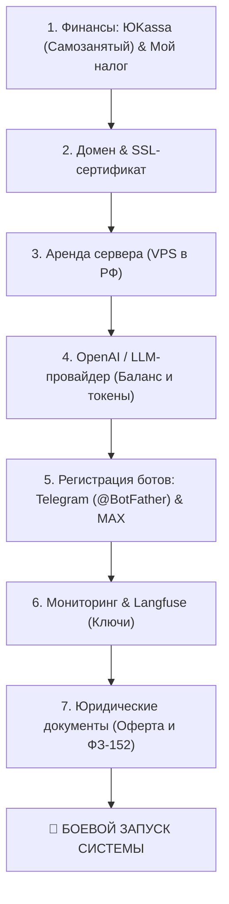

# Пошаговое руководство по запуску в продакшн (Production Launch Guide)

Этот документ — ваша практическая дорожная карта со всеми организационными, финансовыми, инфраструктурными и юридическими шагами, которые необходимо выполнить для запуска проекта в реальную работу.

---

## Чек-лист подготовки к запуску (Краткая сводка)

---

## 1. Юридическая и платёжная часть: ЮKassa и Самозанятость

Вы работаете как **самозанятый (плательщик НПД)**. Для приёма оплат по закону РФ каждый платёж должен фискализироваться в ФНС с выдачей чека клиенту.

### Шаг 1.1. Регистрация в ЮKassa для самозанятых
1. Перейдите на официальный сайт [yookassa.ru](https://yookassa.ru/) и нажмите **«Подключить»**.
2. Выберите статус **«Самозанятый»**.
3. Укажите ваш ИНН, паспортные данные и реквизиты банковской карты физлица (куда будут автоматически зачисляться деньги от селлеров).
4. **Интеграция с «Мой налог»:**
   * В процессе регистрации ЮKassa запросит разрешение на передачу данных в ФНС.
   * Откройте приложение **«Мой налог»** на телефоне ➔ раздел *«Партнёры»* ➔ подтвердите привязку сервиса **ЮKassa**.
   * *Результат:* ЮKassa сама будет формировать чеки и отправлять их клиентам и в налоговую. Налог (4% или 6%) рассчитывается автоматически в приложении «Мой налог».

### Шаг 1.2. Получение боевых API-ключей ЮKassa
1. В личном кабинете ЮKassa перейдите в раздел **«Интеграция» ➔ «Ключи API»**.
2. Скопируйте:
   * **`YOOKASSA_SHOP_ID`** (числовой идентификатор магазина, например `382910`).
   * **`YOOKASSA_SECRET_KEY`** (секретный ключ вида `live_...` или `test_...` для начала).
3. **Настройка Webhook в ЮKassa:**
   * В разделе «Настройки уведомлений» укажите URL вашего сервера:
     `https://api.yourdomain.ru/api/v1/billing/yookassa/webhook`
   * Отметьте событие: `payment.succeeded` (успешная оплата).

---

## 2. Домен и SSL-сертификат

### Нужен ли домен?
**ОБЯЗАТЕЛЬНО ДА.**
1. **Для ЮKassa:** Платёжная система отправляет вебхуки об оплатах только на защищённые `HTTPS`-адреса с валидным сертификатом. На чистый IP-адрес без SSL вебхуки не принимаются.
2. **Для Telegram и MAX:** Вебхуки мессенджеров требуют валидный публичный домен с `HTTPS`.
3. **Для солидности:** Селлеры будут видеть официальный домен сервиса в ссылках на оплату.

### Что сделать:
1. **Покупка домена:**
   * Зарегистрируйте домен в зоне `.ru` (стоимость всего **150–250 ₽ в год**).
   * Рекомендуемые регистраторы: [Timeweb](https://timeweb.cloud/), [Beget](https://beget.com/), [Reg.ru](https://reg.ru/).
   * Примеры названий: `market-ai-bot.ru`, `seller-agent.ru`, `sellerbot-ai.ru`.
2. **Настройка DNS:**
   * В панели управления доменом добавьте `A-запись`, указывающую на IP-адрес вашего арендованного сервера:
     * Имя: `@` ➔ IP сервера.
     * Имя: `api` ➔ IP сервера.
3. **SSL-сертификат (Бесплатно):**
   * На сервере сертификат выпускается бесплатно через **Let's Encrypt / Certbot** за 2 минуты (инструкция ниже).

---

## 3. Аренда сервера (VPS в РФ)

Поскольку проект работает с российскими маркетплейсами (Wildberries, Ozon), российским мессенджером MAX и банками (ЮKassa/СБП), **сервер должен физически находиться в РФ**. Это гарантирует минимальный пинг и исключает риск блокировок со стороны маркетплейсов.

### Рекомендуемые хостинг-провайдеры в РФ:
* **Timeweb Cloud** ([timeweb.cloud](https://timeweb.cloud/)) — отличная панель, быстрая поддержка, почасовая оплата.
* **Selectel** ([selectel.ru](https://selectel.ru/)) — корпоративный уровень, высокая надёжность.
* **Beget** ([beget.com](https://beget.com/)) — простой и надёжный провайдер.

### Минимальные и рекомендуемые характеристики сервера:
| Компонент | Минимум (для старта и тестов) | Рекомендуется (на 100–500 селлеров) |
| :--- | :--- | :--- |
| **Процессор (vCPU)** | 2 ядра | 4 ядра |
| **Оперативная память (RAM)** | 4 GB | 8 GB |
| **Диск (NVMe SSD)** | 40 GB | 80 GB |
| **ОС** | Ubuntu 22.04 LTS или 24.04 LTS | Ubuntu 24.04 LTS |
| **Примерная цена** | ~900–1 400 ₽ / мес | ~1 800–2 600 ₽ / мес |

*Оперативка 8 GB нужна для одновременной комфортной работы: PostgreSQL, Redis, RabbitMQ, Qdrant, Prometheus, Grafana, Loki и нескольких воркеров на Python.*

---

## 4. Доступ к LLM (OpenAI API и оплата)

Система оптимизирована под работу с моделью **`gpt-4o-mini`** (высокая скорость, отличное качество русского языка и крайне низкая цена).

### Проблема:
OpenAI напрямую не принимает банковские карты РФ и блокирует прямые запросы с российских IP-адресов.

### Два практических варианта решения:

#### Вариант А: Использование OpenRouter (РЕКОМЕНДУЕТСЯ)
* **Сервис:** [openrouter.ai](https://openrouter.ai/) — международный агрегатор всех LLM.
* **Плюсы:**
  * Доступ ко всем моделям (`openai/gpt-4o-mini`, `anthropic/claude-3-5-sonnet`, `google/gemini-flash`).
  * Полная совместимость с официальной библиотекой OpenAI (в коде меняется только `base_url`).
  * Баланс пополняется криптовалютой либо через посредников/виртуальные карты.
  * Работает стабильно без блокировок.

#### Вариант Б: Прямой аккаунт OpenAI через зарубежную карту или посредника
* Зарегистрировать аккаунт на [platform.openai.com](https://platform.openai.com/).
* Пополнить баланс на $10–20 через сервисы выпуска виртуальных зарубежных карт (например, Pyypl, Pally, Плати.маркет) или знакомых за рубежом.
* На российском сервере потребуется настроить прокси для исходящих запросов к `api.openai.com`.

---

## 5. Создание и настройка ботов в мессенджерах

### 5.1. Telegram-бот:
1. Откройте в Telegram официального бота **[@BotFather](https://t.me/BotFather)**.
2. Отправьте команду `/newbot`.
3. Задайте отображаемое имя (например, `Marketplace AI Agent`).
4. Задайте username (должен оканчиваться на `bot`, например `SellerReviewsAIBot`).
5. Скопируйте полученный **`TELEGRAM_BOT_TOKEN`** (вида `718293849:AAFn38...`).
6. В `@BotFather` настройте внешний вид:
   * `/setdescription` — текст, который видит пользователь до нажатия кнопки Start.
   * `/setabouttext` — текст в профиле бота.
   * `/setuserpic` — загрузите красивый логотип бота.

### 5.2. MAX-бот (VK):
1. Откройте портал разработчиков [dev.max.ru](https://dev.max.ru/) либо запустите в мессенджере MAX служебного бота **`@MasterBot`** / мини-приложение «MAX для бизнеса».
2. Нажмите **«Создать бота»**.
3. Задайте имя, загрузите аватарку и выберите категорию сервиса.
4. Скопируйте полученный **`MAX_BOT_TOKEN`**.

---

## 6. Сервис трейсинга Langfuse

Для отслеживания расходов на токены, задержек и качества промптов:
1. Зайдите на [cloud.langfuse.com](https://cloud.langfuse.com/).
2. Зарегистрируйте бесплатный аккаунт (в бесплатном тарифе доступно до 50 000 трейсов в месяц — этого с запасом хватит на первые месяцы).
3. Создайте проект `Marketplace_AI_Agent`.
4. В разделе *Settings ➔ API Keys* скопируйте:
   * **`LANGFUSE_PUBLIC_KEY`**
   * **`LANGFUSE_SECRET_KEY`**
   * **`LANGFUSE_HOST`** (`https://cloud.langfuse.com`)

---

## 7. Юридические документы для селлеров (Оферта и ПДн)

Чтобы вы могли легально принимать деньги от селлеров и снимать с себя риски:
1. **Публичная оферта на оказание услуг:**
   * В ней фиксируется: предмет договора (доступ к программному комплексу), стоимость подписки (1000 ₽ / 100 ответов), правила списания и отказ от ответственности за сбои на стороне самих маркетплейсов (Wildberries/Ozon).
2. **Политика обработки персональных данных (ФЗ-152):**
   * Согласие на обработку имени, Telegram/MAX ID и реквизитов магазина.
3. *Как это работает в боте:* При первом нажатии кнопки Start бот выводит строчку: *«Нажимая кнопку "Старт", вы принимаете условия Публичной оферты и Политики конфиденциальности»* со ссылками на документы (документы можно выложить в виде Google Docs или на отдельную страничку).

---

## 8. Итоговая смета регулярных расходов (Экономика проекта)

| Статья расходов | Периодичность | Примерная стоимость |
| :--- | :--- | :--- |
| **Аренда VPS (4 vCPU, 8 GB RAM)** | Раз в месяц | ~1 800 – 2 500 ₽ |
| **Домен в зоне `.ru`** | Раз в год | ~200 ₽ (~17 ₽ / мес) |
| **OpenAI токены (gpt-4o-mini)** | По факту использования | ~$0.00015 за ответ (~15 ₽ за 1000 ответов) |
| **Налог самозанятого (НПД)** | Раз в месяц | 4% (если платит физлицо) или 6% (если ИП/ООО) |
| **ЮKassa эквайринг** | С каждого платежа | ~3.5% за успешную транзакцию |
| **Langfuse (Трейсинг)** | Ежемесячно | 0 ₽ (Free Cloud Tier) |
| **SSL-сертификат** | Каждые 3 месяца | 0 ₽ (Let's Encrypt) |

### Чистая прибыль с 1 подписки (1 000 ₽):
* Комиссия ЮKassa (3.5%): -35 ₽
* Налог НПД (6%): -60 ₽
* Затраты на 100 генераций GPT-4o-mini: ~3–5 ₽
* **Итого чистая маржа:** **~900 ₽ с каждого селлера в месяц (90% маржинальность!)**. При 100 активных селлерах ваш чистый доход составит **~90 000 ₽ / месяц** при расходах на сервер всего ~2 000 ₽.
