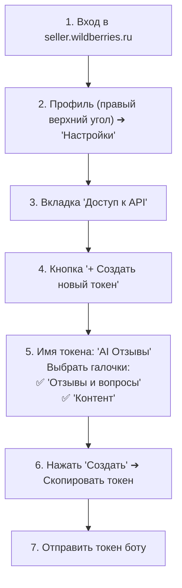
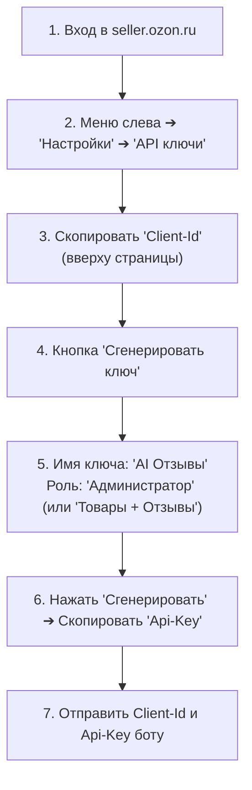

# Руководство по подключению селлеров (Seller Onboarding Guide): Wildberries & Ozon

В данном документе детально разобран весь путь продавца (User Flow), стоимость и условия доступа к API со стороны маркетплейсов, пошаговые инструкции получения ключей и логика работы интерактивного мастера подключения в боте.

---

## 1. Сравнительный анализ условий доступа к API маркетплейсов

| Критерий | Wildberries | Ozon |
| :--- | :--- | :--- |
| **Плата за доступ к API** | **100% БЕСПЛАТНО** | **ПЛАТНО (Требуется подписка)** |
| **Нужна ли подписка маркетплейса?** | **НЕТ.** Подписка «Джем» **не требуется** для стандартных отзывов и вопросов. | **ДА.** Требуется опция «Управление отзывами» или подписка уровня *Premium Pro*. |
| **Что произойдёт без подписки?** | Всё работает штатно. | API вернёт ошибку `HTTP 403 Forbidden` при вызове методов отзывов. |
| **Необходимые параметры авторизации** | Один API-токен (`Authorization`) | Пара: `Client-Id` (число) + `Api-Key` (строка) |
| **Время выпуска ключей селлером** | 1–2 минуты | 2–3 минуты |
| **Целевой сегмент селлеров** | Все селлеры (от новичков до топов) | Средние и крупные селлеры с подключенными опциями Ozon |

---

## 2. Пошаговые инструкции для селлеров (Click-by-Click)

### 2.1. Wildberries: Инструкция получения API-токена

> **Важно для селлера:** Доступ к API отзывов и вопросов на Wildberries полностью бесплатный. Никаких платных подписок («Джем») оформлять не нужно!



#### Текстовая шпаргалка для отображения в боте:
1. Откройте личный кабинет продавца: [seller.wildberries.ru](https://seller.wildberries.ru/).
2. В правом верхнем углу нажмите на название вашей компании/аватар и выберите **«Настройки»**.
3. В левом меню перейдите в раздел **«Доступ к API»**.
4. Нажмите синюю кнопку **«+ Создать новый токен»**.
5. Укажите название токена: например, `AI Агент Отзывов`.
6. Отметьте галочками категории:
   * ✅ **«Отзывы и вопросы»** (чтение и запись);
   * ✅ **«Контент»** (чтение карточек товаров).
7. Нажмите **«Создать»** и скопируйте появившийся длинный токен. *(Обратите внимание: токен отображается полностью только один раз!).*
8. Отправьте скопированный токен сообщением в этот чат.

---

### 2.2. Ozon: Инструкция получения Client-Id и Api-Key

> **Важно для селлера:** Убедитесь, что в вашем личном кабинете Ozon Seller подключена опция **«Управление отзывами»** (раздел «Продвижение/Подписки») либо активна подписка *Premium Pro*. Без этого Ozon блокирует доступ к отзывам через API.



#### Текстовая шпаргалка для отображения в боте:
1. Откройте кабинет: [seller.ozon.ru](https://seller.ozon.ru/).
2. В боковом меню перейдите: **«Настройки» ➔ «API ключи»**.
3. В блоке информации об аккаунте найдите и скопируйте **`Client-Id`** (цифровой ID, например `1234567`).
4. Нажмите кнопку **«Сгенерировать ключ»**.
5. Укажите название: `AI Агент Отзывов`.
6. Выберите роль: **«Администратор»** (рекомендуется для полного доступа к карточкам и отзывам) либо выберите права на «Отзывы» и «Товары».
7. Нажмите **«Сгенерировать»** и сразу скопируйте **`Api-Key`**.
8. Отправьте боту сначала Client-Id, а затем Api-Key.

---

## 3. Полный User Flow онбординга селлера в боте

### Шаг 1: Первый вход селлера (Старт)
* Пользователь нажимает `/start` или кнопку запуска в Telegram / MAX.
* Бот приветствует селлера и показывает постоянное кнопочное меню (Reply Keyboard):
  ```text
  👋 Здравствуйте, Александр!

  Я — интеллектуальный ИИ-ассистент для селлеров Wildberries и Ozon.
  Я автоматизирую ответы на отзывы и вопросы покупателей, учитывая особенности ваших товаров и базы знаний, а негатив моментально присылаю вам на согласование.

  [ 🏢 Подключить магазин ]  [ 🤖 Режим работы ]
  [ 📚 База знаний ]         [ 💳 Тариф и баланс ]
  [ 📊 Аналитика ]           [ 💬 Поддержка ]
  ```

### Шаг 2: Выбор платформы
* Селлер нажимает `[ 🏢 Подключить магазин ]`.
* Бот предлагает выбор:
  ```text
  Выберите платформу для подключения:

  [ 🟣 Wildberries (Бесплатный API) ]
  [ 🔵 Ozon (Требуется опция отзывов) ]
  [ 🧪 Демо / Тестовый магазин ]
  [ 🔙 Назад ]
  ```

### Шаг 3: Интерактивный мастер с инструкцией (Wizard)
* При выборе **Wildberries**:
  * Бот присылает красивое сообщение с краткими шагами со ссылкой на `seller.wildberries.ru`.
  * Бот переходит в состояние FSM `WAITING_WB_TOKEN` и ожидает текстовый ввод.
* При выборе **Ozon**:
  * Бот присылает предупреждение о необходимости опции «Управление отзывами».
  * Сначала запрашивает `Client-Id`, затем `Api-Key`.

### Шаг 4: Мгновенная валидация «на лету» (Live Verification)
* Как только селлер прислал ключ:
  1. Бот показывает статус: `⏳ Проверяю подключение к магазину...`
  2. Воркер делает безопасный тестовый запрос:
     * Для WB: `GET https://feedbacks-api.wildberries.ru/api/v1/feedbacks/count-unanswered`
     * Для Ozon: `POST https://api-seller.ozon.ru/v1/review/count`
  3. **Сценарий А (Успех):**
     * Ключ шифруется алгоритмом AES-256-GCM и сохраняется в БД.
     * Бот радостно сообщает:
       ```text
       🎉 Магазин «SoundMaster Official» успешно подключен!

       📊 Статус магазина:
       • Площадка: Wildberries
       • Новых неотвеченных отзывов: 14
       • Новых вопросов: 3

       ⚙️ Выберите стартовый режим работы:
       [ 🛡 С подтверждением (Рекомендуется для старта) ]
       [ ⚡ Полный авто-ответ ]
       ```
  4. **Сценарий Б (Ошибка токена):**
     * Бот **по-человечески** объясняет проблему:
       * *Для WB:* `❌ Ошибка авторизации (401/403). Похоже, токен скопирован не полностью или в настройках токена не были выбраны галочки «Отзывы и вопросы» и «Контент». Попробуйте пересоздать токен.`
       * *Для Ozon:* `❌ Ошибка доступа Ozon (403 Forbidden). На вашем аккаунте Ozon не активна опция «Управление отзывами» или подписка Premium. Подключите опцию в кабинете Ozon или обратитесь в нашу поддержку.`
       * Кнопки: `[ 🔄 Попробовать снова ]` и `[ 💬 Написать в поддержку Денису ]`.

---

## 4. Требования к UI/UX мастера подключения в боте

1. **Защита от случайного показа токенов в чате:**
   * Сразу после успешной валидации или при ошибке бот **удаляет сообщение селлера с сырым API-токеном** (через метод `delete_message`), чтобы секретные ключи не висели в открытом виде в истории чата Telegram/MAX.
2. **Кнопка отмены на каждом шаге:**
   * Всегда доступна инлайн-кнопка `[ ❌ Отмена ]`, возвращающая селлера в главное меню без зависания FSM-состояния.
3. **Прямая ссылка на техподдержку:**
   * При любой ошибке валидации селлеру предлагается кнопка связи с Денисом, чтобы не терять пользователя при возникновении трудностей с кабинетом маркетплейса.
